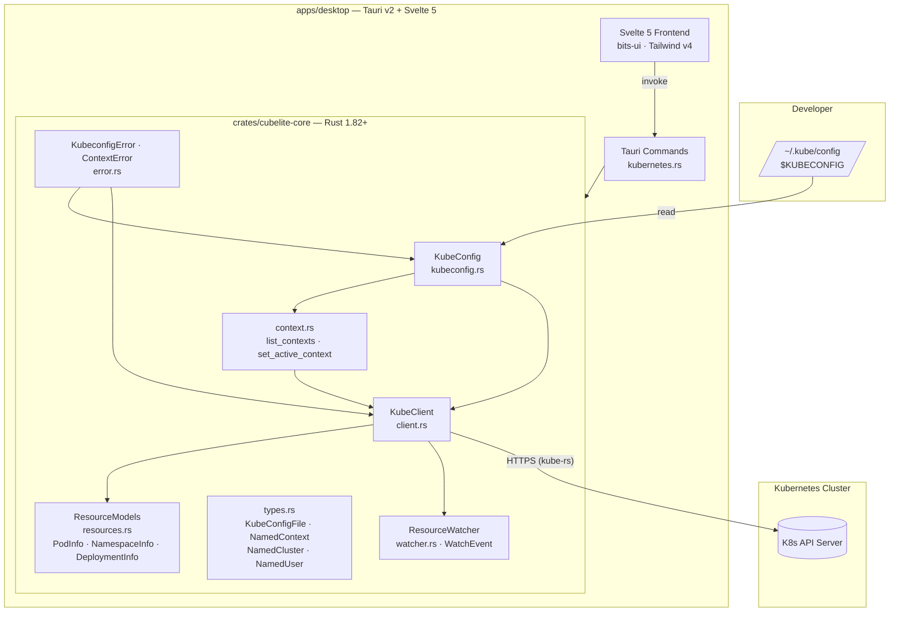

# CubeLite — Architecture

## Overview

CubeLite is a monorepo containing two layers: the Rust core and the Tauri desktop app, which uses the core as a Cargo dependency.

## Component Diagram

## Data Flow

### Desktop app (Tauri)

1. Svelte frontend calls a typed `invoke()` wrapper.
2. The Tauri command handler (Rust) calls into `cubelite-core` — loading the kubeconfig and using `KubeClient` to query the API.
3. Results are serialised as JSON and returned to the frontend.

## Component Reference

### `crates/cubelite-core` — Rust library

| Module | Responsibility |
|---|---|
| `kubeconfig.rs` | Parse YAML kubeconfig, merge multiple files, switch active context, write changes to disk |
| `context.rs` | `list_contexts`, `list_context_infos`, `current_context`, `set_active_context`, `context_exists` — high-level context API |
| `client.rs` | `KubeClient` — async wrapper around kube-rs; lists pods, namespaces, and deployments |
| `resources.rs` | `PodInfo`, `NamespaceInfo`, `DeploymentInfo` — serde-serialisable API response models |
| `types.rs` | `KubeConfigFile`, `NamedContext`, `NamedCluster`, `NamedUser`, `ContextDetails`, `ClusterDetails`, `ContextInfo` — domain types mirroring the kubeconfig spec |
| `watcher.rs` | `ResourceWatcher`, `WatchEvent`, `ResourceInfo`, `ResourceType` — kube-rs watch streaming over Pods, Namespaces, and Deployments |
| `error.rs` | `KubeconfigError` enum (FileNotFound, ParseError, MergeError, ClientError, Io, WatchError); `ContextError` enum (NotFound, Kubeconfig) |

### `apps/desktop` — Tauri v2 + Svelte 5

| Path | Responsibility |
|---|---|
| `src-tauri/src/commands/kubernetes.rs` | Tauri commands: `list_pods`, `list_namespaces`, `list_deployments` |
| `src/routes/` | Svelte page routes |
| `src/lib/components/` | UI components (bits-ui primitives, Tonal design tokens) |

## Technology Stack

| Area | Technology | Version |
|---|---|---|
| Rust core | Rust | 1.82+ |
| Rust core | kube-rs | 0.97 |
| Rust core | tokio | 1 |
| Rust core | thiserror | 2 |
| Rust core | anyhow | 1 |
| Desktop | Tauri | v2 |
| Desktop | Svelte | 5 |
| Desktop | Tailwind CSS | v4 |
| Desktop | bits-ui | 2 |
| CI/CD | GitHub Actions | — |

## Security Model

- No plaintext secrets in code or config files
- Kubernetes credentials stored in the OS Keychain (Keychain on macOS)
- The desktop app reads kubeconfig from disk; no remote config fetching
- No telemetry, no analytics, no call-home of any kind
- Kubernetes Secrets are masked in the UI by default
